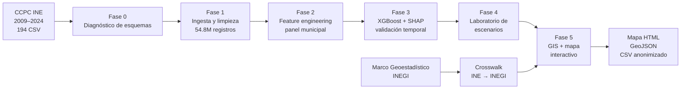

# Geocívica Predictiva

### Inteligencia territorial para anticipar el riesgo de abstención municipal

[](https://www.python.org/)
[](https://xgboost.readthedocs.io/)
[](https://geopandas.org/)
[](https://python-visualization.github.io/folium/)
[](https://ine.mx/transparencia/datos-abiertos/visualizacion-datos/conteos-censales-participacion/)

**Reto 2 — Predicción y escenarios de riesgo de abstención**  
**Hackea la participación: Datos que construyen democracia · INE 2026**  
**Equipo:** Wi'ijados.dev

---

## Qué es

Geocívica Predictiva es un pipeline reproducible de analítica territorial que integra los **Conteos Censales de Participación Ciudadana (CCPC) 2009–2024** del INE con el **Marco Geoestadístico Municipal del INEGI** para:

1. Estimar el **riesgo de abstención municipal** con un modelo supervisado.
2. Explicar los factores que empujan ese riesgo.
3. Simular **escenarios con y sin intervención** de participación juvenil.
4. Traducir los resultados en un **semáforo territorial**, un **mapa interactivo** y una **capa GeoJSON** listos para planeación.

> El producto no identifica personas: trabaja exclusivamente con datos agregados a nivel municipal. No usa datos personales.

---

## Resultados principales

| Indicador | Resultado |
| :--- | ---: |
| Registros crudos procesados | **54,872,341** |
| Panel municipal-elección | **14,779 filas · 2,477 municipios · 32 entidades** |
| Modelo | **XGBoost** con 14 variables disponibles antes de la elección |
| Validación temporal | Entrenamiento 2015–2018 · Validación 2021 · **Prueba 2024** |
| MAE prueba 2024 | **7.64 pp** vs. baseline ingenuo **8.67 pp** |
| RMSE prueba 2024 | **10.86 pp** vs. baseline **12.72 pp** |
| R² prueba 2024 | **0.300** (capacidad predictiva moderada) |
| Escenario +10% voto juvenil | Banda **1.21–4.13 pp** · centro **2.67 pp** |
| Cobertura del mapa | **2,463 / 2,463 municipios del escenario (100%)** |
| Homologación INE → INEGI | **2,471 / 2,477 (99.76%)** |
| Semáforo territorial | **37.9% bajo · 59.0% medio · 3.1% alto** |

**Lectura correcta:** el modelo ordena el riesgo mejor de lo que explica su variación. El escenario es una **banda condicional**, no un efecto causal identificado. El semáforo usa cortes descriptivos de 40% y 50%; no es una clasificación oficial del INE.

---

## Contenido del repositorio

```text
Geocivica_Predictiva/
├── requirements.txt
├── .gitignore
├── scripts/
│   ├── 00_schema_check.py
│   ├── 01_ingesta_limpieza.py
│   ├── 02_feature_engineering.py
│   ├── 03_modelo_explicabilidad.py
│   ├── 04_laboratorio_escenarios.py
│   ├── 04b_crosswalk_ine_inegi.py
│   └── 05_mapa_interactivo.py
├── info/
│   └── README.md
└── resultados/
    ├── mapa_riesgo_2024.html
    ├── mapa_escenarios_2024.geojson
    ├── escenarios_finales_2024.csv
    ├── crosswalk_ine_inegi_2024.csv
    ├── municipios_ine_sin_geometria_2024.csv
    ├── municipios_sin_geometria_2024.csv
    └── vendor/
        ├── leaflet.css
        └── leaflet.js
```

Los scripts `00`–`05` más `04b` forman el pipeline reproducible que genera el mapa, el GeoJSON y las bases CSV.

Este repositorio **no incluye reporte, presentación ni cartas**. Contiene únicamente el código, el mapa ejecutable, la capa GeoJSON y las bases CSV.

---

## El mapa ejecutable

Abre `resultados/mapa_riesgo_2024.html` en un navegador moderno (Chrome, Edge o Firefox).

- Mantén la carpeta `resultados/vendor/` junto al HTML.
- Los polígonos y los datos están embebidos en el archivo.
- El fondo de OpenStreetMap requiere internet; sin conexión, los polígonos y el tablero siguen funcionando.
- El tablero permite explorar riesgo base, riesgo simulado, impacto y semáforo territorial.

---

## GeoJSON final

`resultados/mapa_escenarios_2024.geojson` contiene **2,463 municipios**, en **EPSG:4326**, con geometrías simplificadas a 500 m para uso web y GIS.

Campos principales:

| Campo | Descripción |
| :--- | :--- |
| `clave_ine` / `clave_inegi` | Claves municipales INE e INEGI. |
| `cve_ent` / `cve_mun` | Claves de entidad y municipio. |
| `nombre_entidad` / `nombre_municipio_ine` / `nombre_municipio_inegi` | Nombres territoriales. |
| `riesgo_abstencion_observado` | Abstención observada 2024. |
| `riesgo_base_predicho` | Riesgo estimado por el modelo. |
| `riesgo_simulado_predicho` | Riesgo bajo el escenario de intervención. |
| `impacto_pp` | Reducción estimada en puntos porcentuales. |
| `semaforo` | Bajo (<40%), medio (40–50%) o alto (≥50%). |
| `limitado_por_clip` | Indica si la simulación alcanzó el tope de 100%. |

Puede abrirse en QGIS, ArcGIS, kepler.gl o cualquier lector compatible con GeoJSON.

---

## Base de datos anonimizada

`resultados/escenarios_finales_2024.csv` contiene **2,463 municipios** y **17 columnas**. No incluye nombres, direcciones, identificadores personales ni registros individuales.

| Columna | Descripción |
| :--- | :--- |
| `EDOCVE` | Clave de entidad federativa. |
| `MPIOCVE` | Clave de municipio. |
| `AELEC` | Año de la elección (2024). |
| `riesgo_abstencion` | Tasa observada de abstención municipal. |
| `lista_nominal_total` | Lista nominal municipal agregada. |
| `tasa_jovenes_ln` | Proporción de jóvenes en la lista nominal. |
| `tasa_voto_jovenes` | Tasa observada de voto juvenil. |
| `tasa_voto_jovenes_simulada` | Tasa juvenil simulada con intervención (+10% relativo). |
| `lag_riesgo_abstencion_1` | Rezago del riesgo de abstención. |
| `prediccion_riesgo_base` | Riesgo base estimado por el modelo. |
| `prediccion_riesgo_simulado` | Riesgo estimado bajo el escenario de intervención. |
| `impacto_intervencion` | Diferencia base − simulado. |
| `impacto_contable` | Componente contable de la banda. |
| `impacto_asociativo` | Componente asociativo de la banda. |
| `impacto_central` | Punto medio de la banda condicional. |
| `limitado_por_clip` | Indica si la tasa simulada alcanzó el tope de 100%. |
| `error_base_vs_observado` | Diferencia entre predicción base y observado. |

`resultados/crosswalk_ine_inegi_2024.csv` documenta la homologación de claves y nombres INE → INEGI.

---

## Arquitectura del pipeline



### Fases

| Fase | Script | Función |
| :---: | :--- | :--- |
| 0 | `00_schema_check.py` | Diagnóstico no destructivo de esquemas y detección de archivos atípicos. |
| 1 | `01_ingesta_limpieza.py` | Ingesta por bloques, validación contable, limpieza y consolidación a Parquet. |
| 2 | `02_feature_engineering.py` | Agregación municipal, tasas, rezagos y panel municipio-elección. |
| 3 | `03_modelo_explicabilidad.py` | Entrenamiento XGBoost, evaluación temporal y explicabilidad SHAP. |
| 4 | `04_laboratorio_escenarios.py` | Simulación contable-asociativa de una intervención juvenil. |
| 4b | `04b_crosswalk_ine_inegi.py` | Homologación de claves y nombres INE → INEGI. |
| 5 | `05_mapa_interactivo.py` | Join espacial, simplificación de geometrías, mapa Leaflet y GeoJSON. |

---

## Inicio rápido

### 1. Crear el entorno

```powershell
python -m venv .venv
.venv\Scripts\Activate.ps1
pip install -r requirements.txt
```

### 2. Preparar los datos

El pipeline espera la estructura del entorno original:

```text
Proyecto_INE/
├── Prueba_2/
│   ├── CCPC/
│   │   ├── DatosAbiertos_DECEyEC_ConteosCensales2009/
│   │   ├── ...
│   │   └── DatosAbiertos_DECEyEC_ConteosCensales2024/
│   ├── conjunto_de_datos/
│   │   └── 00mun.shp
│   └── salida/
└── Geocivica_Predictiva/
    ├── scripts/
    ├── info/
    └── resultados/
```

Los scripts conservan las rutas relativas del proyecto original. Si tus datos están en otra ubicación, usa los argumentos `--root`, `--input-root`, `--out-root`, `--input`, `--dataset` y `--cartografia`.

### 3. Ejecutar el pipeline

Desde la raíz de `Geocivica_Predictiva`:

```powershell
# Fase 0: diagnóstico de esquemas
python scripts/00_schema_check.py --root ..\Prueba_2

# Fase 1: ingesta y limpieza
python scripts/01_ingesta_limpieza.py `
  --input-root ..\Prueba_2\CCPC `
  --out-root ..\Prueba_2\salida

# Fase 2: panel municipal
python scripts/02_feature_engineering.py `
  --phase1-out-root ..\Prueba_2\salida `
  --out-root ..\Prueba_2\salida

# Fase 3: modelo y explicabilidad
# Sustituye <timestamp> por la carpeta generada en Fase 2
python scripts/03_modelo_explicabilidad.py `
  --input ..\Prueba_2\salida\fase2_<timestamp>\features_municipales.parquet `
  --out scripts\salida

# Fase 4: escenarios
python scripts/04_laboratorio_escenarios.py `
  --dataset ..\Prueba_2\salida\fase2_<timestamp>\features_municipales.parquet

# Fase 5: mapa interactivo y GeoJSON
python scripts/05_mapa_interactivo.py `
  --cartografia ..\Prueba_2\conjunto_de_datos\00mun.shp
```

Las salidas intermedias se generan en `scripts/salida/`. Los archivos publicables ya están en `resultados/`.

---

## Privacidad y ética

- **Sin datos personales:** todo el análisis se realiza con información agregada y disociada a nivel municipal.
- **Sin imputación silenciosa:** los municipios con variables incompletas se excluyen y se documentan.
- **Validación temporal estricta:** el modelo se entrena con información anterior a 2024 y se evalúa en 2024.
- **Sin fuga de información:** no se usan variables contemporáneas al resultado ni la variable objetivo como predictor.
- **Comunicación responsable:** el escenario se presenta como banda condicional, no como promesa causal.

---

## Limitaciones

- No hay aleatorización ni contrafactual observado: **no se demuestra causalidad**.
- El análisis es municipal: existe riesgo de **falacia ecológica**.
- La tasa juvenil y el riesgo comparten lista nominal y votos: hay **asociación mecánica** parcial.
- El modelo entrenado hasta 2018 puede no capturar cambios estructurales de 2024–2027.
- El semáforo es una herramienta descriptiva de priorización, no una clasificación oficial.

---

## Repositorio

**https://github.com/KHMaxDev/Geocivica_Predictiva**

---

## Equipo

**Wi'ijados.dev**  
Proyecto desarrollado para el Reto 2 de la convocatoria **Hackea la participación: Datos que construyen democracia** del Instituto Nacional Electoral (INE), 2026.

Los derechos patrimoniales de los trabajos se ceden al INE por 10 años, conforme a la convocatoria, para fines institucionales y/o educativos. La autoría intelectual se conserva.
